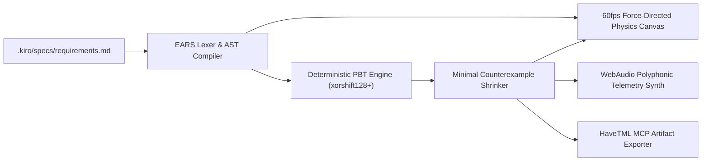

# Technical Design Document — ChimeraForge

## 1. Architecture Overview (The Frankenstein Chimera)
ChimeraForge bridges static specification prose, stochastic property-based fuzzing, physics-based canvas rendering, and polyphonic WebAudio synthesis into a single cohesive pipeline:

## 2. Correctness Properties (Property-Based Testing Specifications)
To move beyond brittle example-based unit tests, Kiro guided us to define three universal algebraic properties verified across 100+ randomized runs per build:

- **Property 1 (Round-Trip Serialization Invariant)**:
  For any valid AST node $N$, serializing $N$ to canonical EARS markdown and re-parsing must yield an isomorphic AST node:
  $$\forall N \in \text{ValidAST}: \text{parse}(\text{format}(N)) \equiv N$$
- **Property 2 (Deterministic Seed Reproducibility)**:
  For any PRNG seed $s \in \mathbb{Z}^+$ and specification document $D$, two executions of $\text{runPBT}(D, s)$ must produce the exact same sequence of 100 test vectors and identical minimal counterexamples.
- **Property 3 (Monotonic Shrinking Termination)**:
  For any failing input vector $x_0$ of length $L$, the shrinker must terminate in at most $\lceil \log_2(L) \rceil + 16$ steps and output a minimal failing vector $x^*$ such that $|x^*| \le |x_0|$ and $\text{predicate}(x^*) = \text{false}$.

## 3. Component Breakdown
- `src/chimera-core.js`: Isomorphic EARS parser, AST validator, and round-trip formatter (runs identically in Node.js CLI and Browser).
- `src/pbt-runner.js`: Seeded `xorshift128+` generator, string/object combinators, and binary-search counterexample shrinker.
- `src/audio-alchemist.js`: WebAudio polyphonic synthesizer with stereo delay, resonant low-pass filter (`BiquadFilterNode`), and envelope shaping.
- `index.html`: Zero-build Cyber-Gothic Frankenstein laboratory UI with live EARS editor, 60fps topology canvas, PBT fuzzing console, and MCP payload exporter.
